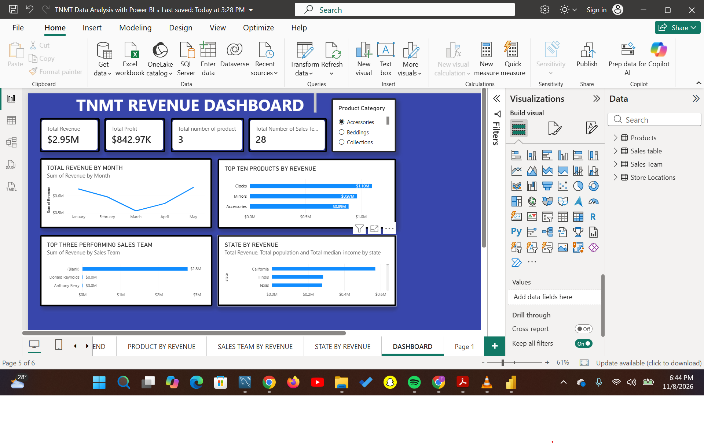

# 📊 TNMT Revenue Dashboard | Power BI Sales Analysis


An end-to-end business intelligence project that turns raw sales data into an interactive revenue dashboard. The report tracks revenue, profit, product performance, sales team performance and geographic distribution, helping decision-makers see **what is selling, who is selling it, and where**.

---

## 🖼️ Dashboard Preview



---

## 📌 Table of Contents

- [Project Overview](#-project-overview)
- [Business Questions](#-business-questions)
- [Dataset & Data Model](#-dataset--data-model)
- [Tools & Skills](#-tools--skills)
- [Project Workflow](#-project-workflow)
- [Report Pages](#-report-pages)
- [Key Insights](#-key-insights)
- [Recommendations](#-recommendations)
- [How to Use](#-how-to-use)
- [Author](#-author)

---

## 🧭 Project Overview

TNMT is a retail business selling home décor and lifestyle products across several U.S. states. Management needed a single, easy-to-read view of company performance instead of scattered spreadsheets.

This project delivers a multi-page Power BI report with a one-screen executive dashboard that summarises:

| KPI | Value |
|---|---|
| 💰 **Total Revenue** | **$2.95M** |
| 📈 **Total Profit** | **$842.97K** |
| 🏷️ **Product Categories** | **3** (Accessories, Beddings, Collections) |
| 👥 **Sales Team Members** | **28** |

That works out to a **profit margin of roughly 28.6%**.

---

## ❓ Business Questions

The dashboard was designed to answer these questions:

1. What are the total revenue and profit generated by the business?
2. How does revenue trend from month to month?
3. Which products generate the most revenue?
4. Which sales team members are the top performers?
5. Which states contribute the most revenue, and how does this relate to population and median income?
6. How does performance change across product categories?

---

## 🗂️ Dataset & Data Model

The model is built on four related tables arranged in a **star schema**, with the sales table as the central fact table:

| Table | Type | Description |
|---|---|---|
| `Sales table` | Fact | Transactions, revenue, cost and profit |
| `Products` | Dimension | Product names and categories |
| `Sales Team` | Dimension | Sales representatives and team details |
| `Store Locations` | Dimension | Store state, population and median income |

Relationships are one-to-many from each dimension table to the sales fact table, which keeps filtering fast and predictable across every visual.

---

## 🛠️ Tools & Skills

| Tool / Skill | How it was used |
|---|---|
| **Power BI Desktop** | Report design, visuals and interactivity |
| **Power Query** | Importing, cleaning and transforming raw data |
| **Data Modeling** | Star schema design and table relationships |
| **DAX** | KPI measures such as revenue, profit and counts |
| **Data Visualization** | Cards, line charts, bar charts and slicers |
| **Storytelling** | Turning numbers into clear business insights |

### Sample DAX Measures

```dax
Total Revenue = SUM('Sales table'[Revenue])

Total Profit = SUM('Sales table'[Profit])

Profit Margin % = DIVIDE([Total Profit], [Total Revenue], 0)

Total Number of Sales Team = DISTINCTCOUNT('Sales Team'[Sales Team])

Total Number of Product = DISTINCTCOUNT(Products[Category])
```

---

## 🔄 Project Workflow

```
Raw Data ➜ Power Query (Clean & Transform) ➜ Data Model (Star Schema)
        ➜ DAX Measures ➜ Visuals & Slicers ➜ Insights & Recommendations
```

1. **Data import** – loaded the four source tables into Power BI.
2. **Data cleaning** – fixed data types, removed duplicates, handled nulls and standardised column names in Power Query.
3. **Data modeling** – connected the tables in a star schema.
4. **Measures** – created reusable DAX measures for every KPI.
5. **Visualization** – built analysis pages and a consolidated executive dashboard.
6. **Interactivity** – added a Product Category slicer so users can filter every visual at once.

---

## 📑 Report Pages

| Page | Purpose |
|---|---|
| **Product by Revenue** | Deep dive into product-level revenue performance |
| **Sales Team by Revenue** | Revenue contribution of each sales representative |
| **State by Revenue** | Revenue by state alongside population and median income |
| **Dashboard** | One-page executive summary combining all key metrics |

### Dashboard Visuals

- **KPI cards** – Total Revenue, Total Profit, Number of Product Categories, Number of Sales Team Members
- **Line chart** – Total Revenue by Month (January to May)
- **Bar chart** – Top Products by Revenue
- **Bar chart** – Top Three Performing Sales Team
- **Bar chart** – Revenue by State with population and median income
- **Slicer** – Product Category (Accessories, Beddings, Collections)

---

## 💡 Key Insights

- **Strong profitability:** The business generated **$2.95M in revenue** and **$842.97K in profit**, a healthy margin of about **28.6%**.
- **Mid-quarter dip, strong recovery:** Revenue declined from January to a **low point in March**, then climbed steadily to its **highest level in May**.
- **Clocks lead product sales:** **Clocks ($1.10M)** are the top revenue product, followed by **Mirrors ($0.97M)** and **Accessories ($0.89M)**.
- **California dominates geographically:** **California** is the top-earning state, ahead of **Illinois** and **Texas**.
- **Data quality finding:** Most revenue appears under a **(Blank)** sales team entry, meaning many transactions are not linked to a sales representative. Spotting this gap is itself a valuable result, since it shows where record-keeping needs improvement before sales team performance can be measured fairly.

---

## ✅ Recommendations

1. **Investigate the March slowdown** and repeat the strategies that drove the April–May recovery.
2. **Prioritise Clocks and Mirrors** in inventory planning and marketing, as they drive the largest share of revenue.
3. **Grow presence in high-performing states** like California, and test targeted campaigns in Illinois and Texas.
4. **Fix the sales team data link** by making sure every transaction is assigned to a representative, so team performance and incentives can be tracked accurately.

---

## 🚀 How to Use

1. Clone this repository:
   ```bash
   git clone https://github.com/your-username/your-repo-name.git
   ```
2. Install [Power BI Desktop](https://powerbi.microsoft.com/desktop/) (free).
3. Open the `.pbix` file in Power BI Desktop.
4. Use the **Product Category** slicer and click on any visual to explore the data interactively.

---

## 📁 Repository Structure

```
├── images/
│   └── dashboard.png          # Dashboard screenshot
├── TNMT Data Analysis with Power BI.pbix
└── README.md
```

---

## 👤 Author 

**Favour Ntoimo**
Data Analyst | Power BI | Excel | SQL

- 💼 LinkedIn: [linkedin.com/in/your-profile](www.linkedin.com/in/favour-ntoimo-esq-09974a274)
- 📧 Email: fntoimo@gmail.com.com
- 🌐 Portfolio: [your-portfolio-link](https://your-portfolio-link)

---

⭐ If you found this project useful or interesting, please consider giving it a star!
